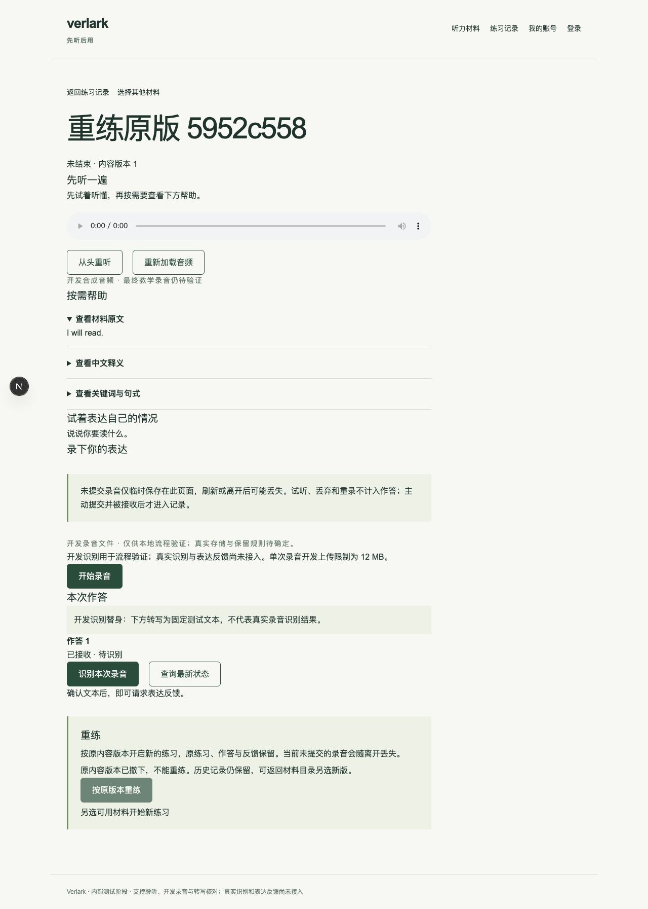
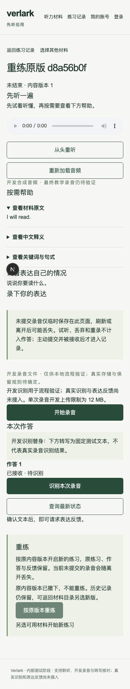

# #14：历史重练与内容版本维护

日期：2026-10-11。起点 `95fc042`，分支 `implement/issue-14`。本票交付历史重练及项目维护发布／撤下，不代表首版或真实存储验收完成。

## 交付

- 历史详情提供“按原版本重练”：校验真实会话、原练习所有权及原版可用性后，新建独立未结束练习。原作答及反馈保持原归属，不复制进新练习。
- 目录开始取最高可用版本；新版不自动撤下旧版。内容正文、任务、释义、提示仍为不可变数据库快照；历史读取不依赖源 JSON 是否随当前部署提供。
- `content:publish` 输出版本 UUID；维护者使用 `content:withdraw <UUID>` 撤下。撤下不删除历史，也不自动替换重练版本。重复发布撤下版本不会重新上架。没有内容管理后台或对用户开放的维护 HTTP 接口。
- `learning-content` 公开可用版本读取在调用方创建事务内持有共享行锁，撤下更新该行时等待创建提交，避免检查可用后又用已撤下版本创建。模块通过公开接口共享基础设施事务上下文；练习模块没有跨模块内容表查询。
- 迁移 `0008_repeat-practice` 增加可空 `repeat_of_id`，只用于区分重练请求身份，不向页面暴露。无外键，原练习删除不影响独立新练习。重复请求绑定学习者、请求 UUID 与原练习，同一请求并发及响应丢失重发返回同一新练习；混用目录入口或更换原练习返回冲突。
- 请求入口限定同源、严格校验请求体且限制 1 KB。浏览器只显示已知错误码的本地中文说明，不展示外部错误正文。撤下后的历史有明确说明及另选材料链接，禁用重练按钮；写入时仍重新检查。

## 测试与红绿证据

沿用首版 Testing Decisions：模块公开 API、真实隔离 PostgreSQL，浏览器连接真实会话及 HTTP；录音文件仍为显式开发能力。

1. 独立重练测试先因缺少 `repeat` 失败，最小实现后通过。
2. 撤下测试先因缺少 `withdraw` 失败，实施后验证历史保留、重练拒绝、目录新版及不能重新上架。
3. 八个并发重复请求先触发唯一约束错误，增加持久请求来源及冲突检查后通过。
4. 两个并发时序测试在真实内容公开接口返回后暂停创建，启动撤下并验证其等待；临时移除共享行锁时均观察到撤下过早完成而失败，恢复锁后通过。屏障仅控制调度，内容和数据库实现均真实。
5. 浏览器先因缺少“按原版本重练”按钮失败，界面实施后桌面和手机视口通过。首次绿色尝试暴露同名测试材料定位冲突，改为随机标题并在 finally 撤下测试版本后两项通过。

已执行：完整模块 suite 10 文件、67 项通过；其中重练新增 5 项。Chromium 桌面 1280×800 与手机视口 390×844 新增 2 项通过，验证原版／新版选择、旧作答不变、新记录独立、响应丢失重发、匿名／跨账号／跨站／伪造字段拒绝、撤下竞争及中文提示、无水平溢出。既有“移除源文件仍读取历史”公开接口测试随完整 suite 通过。

类型检查、lint（零警告）、格式检查、生产构建通过。两个随机空测试数据库完整迁移、重复迁移、持久化读写与重建均通过。

本票测试仅使用 root 为此次并行任务分配的独立 PostgreSQL 模块库与浏览器库。未访问既有应用数据库或远端服务。复现：`TEST_DATABASE_URL=… pnpm test`、`E2E_DATABASE_URL=… pnpm test:e2e tests/e2e/repeat.spec.ts`。

## 未执行与边界

- 结束操作仍属 #13；本票未实现它，也未宣称通过“主动结束后重练、结束只读”的完整流程组合验收。
- 材料音频可用性／保留／清理按最终存储方案另验。浏览器音频是现有开发材料，固定录音字节不代表真实语音质量。
- 未验证真机、Safari、Android、Vercel／Neon 网络与实际部署，不声称学习效果或生产文件策略已经成立。

## 界面证据

